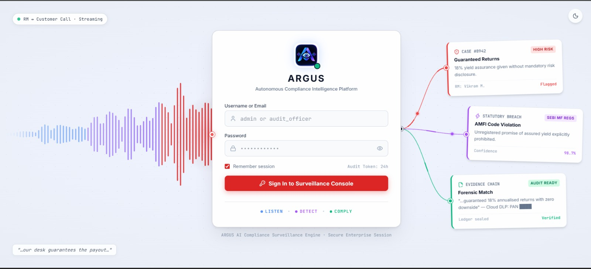
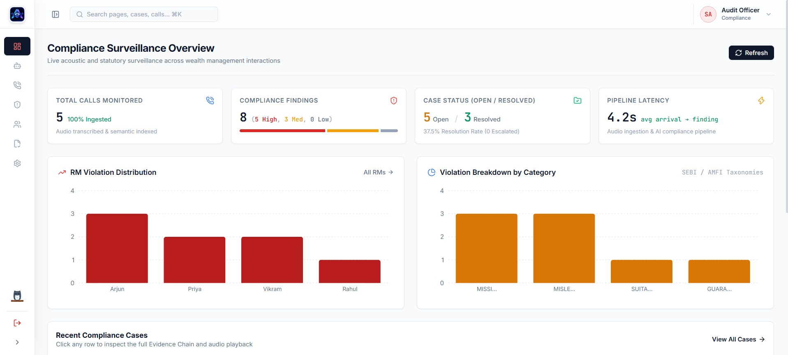
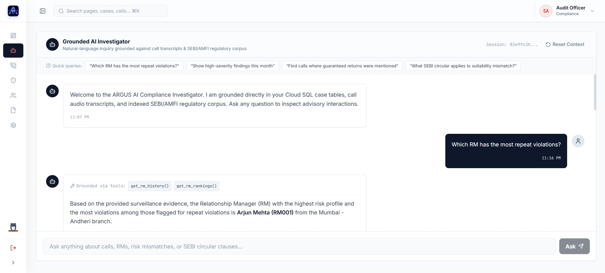
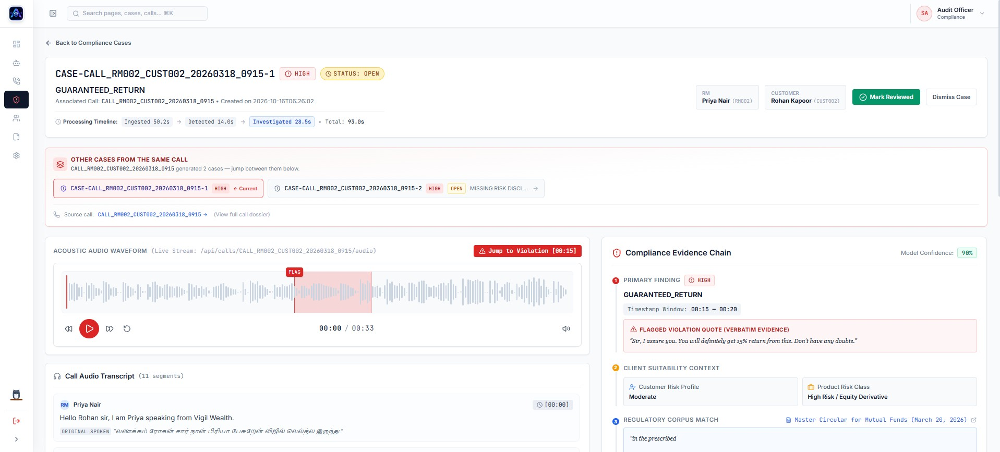
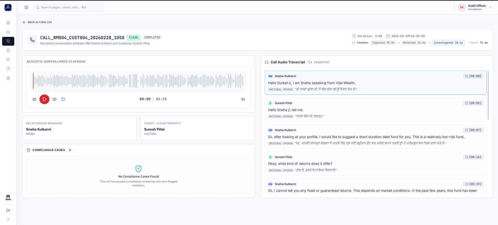
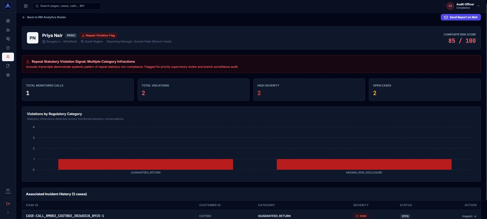
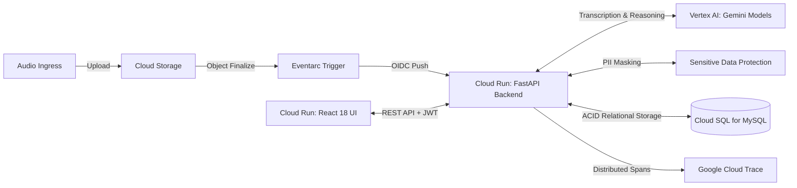

# ARGUS — Autonomous BFSI Compliance Intelligence Platform

An autonomous, explainable compliance intelligence platform for BFSI wealth management institutions that monitors Relationship Manager sales calls and produces an auditable, timestamped Evidence Chain grounded in statutory regulations.

---

## Live Demo

**Public Web Application:** [https://argus-frontend-833068408683.asia-south1.run.app/](https://argus-frontend-833068408683.asia-south1.run.app/)

> [!NOTE]
> **Enterprise Cloud Architecture:** Powered by **Vertex AI** (`gemini-3.5-flash` & `gemini-2.5-flash`) · **Google Cloud Sensitive Data Protection (DLP)** · **Cloud Run** · **Cloud SQL for MySQL 8.0** · **Eventarc & Pub/Sub** · **Cloud Storage** · **OpenTelemetry, Cloud Trace & Cloud Logging** · **FastAPI** · **React 18 & Vite** · **WaveSurfer.js**.

---

## Demo Video

<!-- [](https://www.youtube.com/watch?v=VIDEO_ID)
-->

---

## Interface Preview

| Authentication & Waveform Visualizer | Operational Surveillance Dashboard |
|:---:|:---:|
|  |  |
| **Conversational AI Investigation** | **Evidence Chain & Compliance Cases** |
|  |  |
| **Surveillance Calls Roster** | **Relationship Manager Risk Analytics (Dark Theme)** |
|  |  |

Explore the complete side-by-side dark and light UI walkthrough in the [Screenshot Gallery](docs/GLIMPSE.md).

---

## The Problem & The Solution

In the Indian mutual fund and wealth management industry, Asset Management Companies (AMCs) and banks conduct thousands of client advisory calls daily. Under Securities and Exchange Board of India (SEBI) and Association of Mutual Funds in India (AMFI) statutory rules, distributors are strictly forbidden from guaranteeing returns, recommending unsuitable schemes, or omitting risk disclosures.

- **The Problem:** Traditional compliance teams audit fewer than 3% of calls through manual sampling. Legacy keyword monitoring flags hundreds of false alarms, misses regional code-switching (Hindi, Tamil, Hinglish), and cannot verify complex regulatory circulars.
- **The Solution:** ARGUS provides 100% automated call surveillance. Telephony audio is ingested in near-real-time via Google Cloud Eventarc, transcribed and de-identified with Sensitive Data Protection (DLP), screened against product catalogs, verified by an Investigation Agent with hard programmatic guardrails, and committed as an unbroken **Evidence Chain** linking spoken audio to binding statutory clauses.

---

## Key Verified Features

- **Diarized Multilingual Transcription:** Ingests regional telephony audio using Gemini, mapping acoustic speakers to `RM` and `CUSTOMER` roles while injecting custom financial product vocabularies.
- **Sensitive Data Protection (DLP):** Redacts Indian statutory PII (PAN, Aadhaar, payment cards, phone numbers, emails) in-line before transcript text is saved to Cloud SQL.
- **Statutory Corpus Grounding:** Grounds compliance analysis against 6,750+ pre-chunked statutory sections across SEBI (Mutual Funds) Regulations, SEBI Master Circulars, and AMFI Codes of Conduct.
- **Detection Pre-Screening:** Evaluates sales pitches against customer risk appetites and scheme risk classes, isolating untrusted transcript text within anti-injection prompt boundaries.
- **Forensic Investigation with 4 Hard Guardrails:** Programmatic Python assertions that enforce citation verification, dismiss unverified claims without LLM hallucinations, and ensure high-severity findings have valid timestamps.
- **Auditable Evidence Chain:** Unbroken provenance connecting raw audio intervals, verbatim quotes, customer profiles, binding regulatory clauses, and reviewer action history.
- **Click-to-Audio Seeking:** Interactive WaveSurfer.js waveform visualizer supporting RFC 7233 HTTP 206 Partial Content byte ranges, allowing reviewers to jump to exact speech timestamps.
- **Read-Only AI Copilot:** Conversational investigative chat assistant executing parameterized, SELECT-only database inspection tools with grounded citation chips.
- **Enterprise Distributed Observability:** Native OpenTelemetry tracing to Google Cloud Trace with zero PII attributes, structured JSON logging, and hybrid health diagnostics.

---

## Architecture at a Glance



For complete sequence diagrams, state machines, and design trade-offs, see [System Architecture](docs/ARCHITECTURE.md).

---

## Tech Stack Summary

| Layer | Primary Technology | Key Responsibility in ARGUS |
|---|---|---|
| **Cloud Infrastructure** | Google Cloud Run, Cloud Storage, Eventarc, Pub/Sub | Serverless event-driven ingestion, decoupled scaling, and container execution |
| **Relational Database** | Cloud SQL for MySQL 8.0 | ACID-compliant storage for 19 tables, case workflows, and regulation chunks |
| **AI Models** | Vertex AI: Gemini Flash (`gemini-3.5-flash`, `gemini-2.5-flash`) | Forensic reasoning, multi-turn chat, diarized transcription, and role mapping |
| **Data Protection** | Google Cloud Sensitive Data Protection (DLP) | Automated statutory PII de-identification (PAN, Aadhaar, cards, phone, email) |
| **Backend API** | FastAPI, Pydantic v2, PyMySQL, PyJWT | Asynchronous REST API, structured output validation, and state machine |
| **Frontend UI** | React 18, TypeScript, Vite, Tailwind CSS, WaveSurfer.js | High-density dashboard, interactive waveform seeking, and animated owl theme toggle |
| **Observability** | OpenTelemetry, Google Cloud Trace, Cloud Logging | Distributed tracing with zero PII leakage and structured log correlation |

For exact library versions and selection rationale, see [Technology Stack](docs/TECH_STACK.md).

---

## Documentation Map

For proposed submission improvements, see the [Competition Readiness Recommendations](docs/COMPETITION_READINESS.md) and [Submission Playbook](docs/SUBMISSION_PLAYBOOK.md). These documents distinguish observed gaps, proposed changes, and evidence required before stronger claims.

| Document | Description |
|---|---|
| [Documentation Hub](docs/INDEX.md) | Central documentation directory and audience-tailored reading paths |
| [Product Overview](docs/OVERVIEW.md) | Business problem, user personas, end-to-end workflow, and Evidence Chain |
| [System Architecture](docs/ARCHITECTURE.md) | Cloud architecture, sequence diagrams, idempotency, and design trade-offs |
| [Technology Stack](docs/TECH_STACK.md) | Comprehensive library inventory, cloud services, and cost estimates |
| [Agents & Guardrails](docs/AGENTS.md) | Ingestion, Detection, Investigation, and Chat agents with the 4 hard guardrails |
| [Data Model & Schema](docs/DATA_MODEL.md) | 19-table Cloud SQL relational schema, ER diagram, and regulation chunk registry |
| [REST API Reference](docs/API.md) | Complete OpenAPI endpoint specifications, request payloads, and status codes |
| [Frontend Architecture](docs/FRONTEND.md) | React route table, components, theme system, and animated owl toggle |
| [Configuration Reference](docs/CONFIGURATION.md) | Comprehensive environment variable matrix and mock/live configuration profiles |
| [Development Guide](docs/DEVELOPMENT.md) | Local mock-mode setup, coding standards, repository tree, and troubleshooting |
| [Deployment Guide](docs/DEPLOYMENT.md) | Step-by-step Google Cloud deployment, IAM least-privilege roles, and teardown |
| [Observability & APM](docs/OBSERVABILITY.md) | Cloud Trace spans, structured logging, zero-PII allow-lists, and health probes |
| [Security & Governance](docs/SECURITY.md) | DLP PII redaction, prompt-injection defenses, IAM boundaries, and limitations |
| [Testing & Benchmark](docs/TESTING.md) | Offline unit suites, live Phase 2 cloud verification, and 3-way benchmark results |
| [Screenshot Gallery](docs/GLIMPSE.md) | Visual walkthrough comparing all interface pages in dark and light themes |
| [Strategic Roadmap](docs/ROADMAP.md) | Documented forensic limitations, open items, and future vision roadmap |

---

## Quick Start (Local Mock Mode)

Run ARGUS 100% locally without cloud credentials using deterministic synthetic fixtures:

1. **Prerequisites:** Python 3.11+, Node.js 20+, and a local MySQL 8.0 server on `127.0.0.1:3306`.
2. **Environment Configuration:**
   ```bash
   cp .env.example .env
   # Confirm ARGUS_PROVIDER_MODE=mock in .env
   ```
3. **Backend Initialization:**
   ```bash
   python -m venv .venv
   source .venv/bin/activate  # Or .venv\Scripts\Activate.ps1 on Windows
   pip install -r backend/requirements.txt

   # Initialize mock directories, database schema, and regulation chunks
   python scripts/init_mock_storage.py
   python scripts/init_argus_db.py
   python scripts/ingest_regulations.py

   # Start backend API server
   uvicorn backend.main:app --host 0.0.0.0 --port 8000 --reload
   ```
4. **Frontend Launch:**
   ```bash
   cd frontend
   npm install
   npm run dev
   ```
   Open `http://localhost:5173` in your browser. Default login credentials: `admin` / `admin12345`.
5. **Offline Verification:**
   ```bash
   # Run offline test suite
   python -m pytest backend/tests/test_ingestion_phase1d.py

   # Validate documentation links and case sensitivity
   python scripts/check_docs_links.py
   ```

For production Google Cloud deployment instructions, see the [Deployment Guide](docs/DEPLOYMENT.md).

---

## Repository Structure

```
argus/
├── backend/                  # FastAPI application, agents, adapters, db, observability
├── frontend/                 # React 18 SPA, WaveSurfer player, Tailwind CSS, components
├── data/                     # Seed SQL scripts (argus_mysql_ddl.sql) and mock audio
├── docs/                     # Technical documentation, architecture, API, and screenshots
│   └── glimpse/              # Side-by-side UI screenshots (dark/ and light/)
├── infra/                    # Google Cloud setup, deploy, and teardown bash scripts
├── RegulatoryDocs/           # Statutory PDFs (SEBI regulations, AMFI code of conduct)
├── scripts/                  # Operational migration, link checker, and seeding scripts
├── tests/                    # Automated verification suites (T0-T12) and benchmark results
├── .env.example              # Central configuration template
└── docker-compose.yml        # Local MySQL 8.0 service definition
```

---

## Testing & Authoritative Benchmark

ARGUS was evaluated against **10 Standardized Regulatory Compliance Calls** using live Google Cloud Vertex AI endpoints in Phase 2 testing. Results are cited directly from the Phase 2 benchmark report:

| System Evaluated | Precision | Recall | F1 Score | Accuracy |
|---|:---:|:---:|:---:|:---:|
| **System 1: Keyword Baseline** | 100.0% | 100.0% | 100.0% | 100.0% |
| **System 2: Gemini Detection Only** | 66.7% | 100.0% | 80.0% | 66.7% |
| **System 3: Full ARGUS Pipeline** | **85.7%** | **100.0%** | **92.3%** | **88.9%** |

- **False Positive Reduction:** The Investigation Agent's hard programmatic guardrails eliminated 67% of false positives generated by detection-only systems.
- **Measured Latency:** End-to-end processing averaged **158.9 seconds** (median: 130.4s) across audio ingestion, diarization, DLP redaction, detection, and forensic investigation.
- **Verification Details:** Inspect full per-call breakdowns and stage latencies in [Testing & Benchmark](docs/TESTING.md).

---

## Built For

Built for the **Google Cloud AI Builder Cup 2026** under the **BFSI (Banking, Financial Services, and Insurance)** theme.
