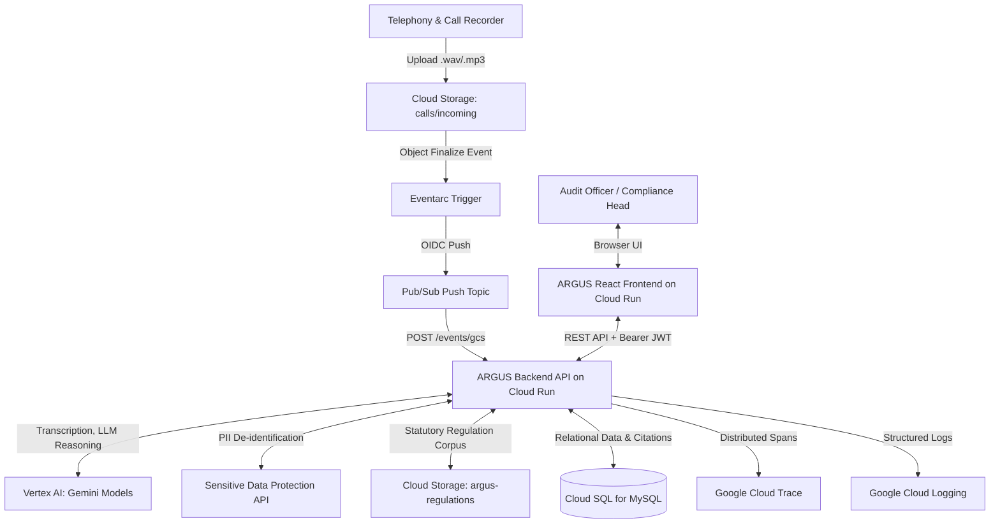
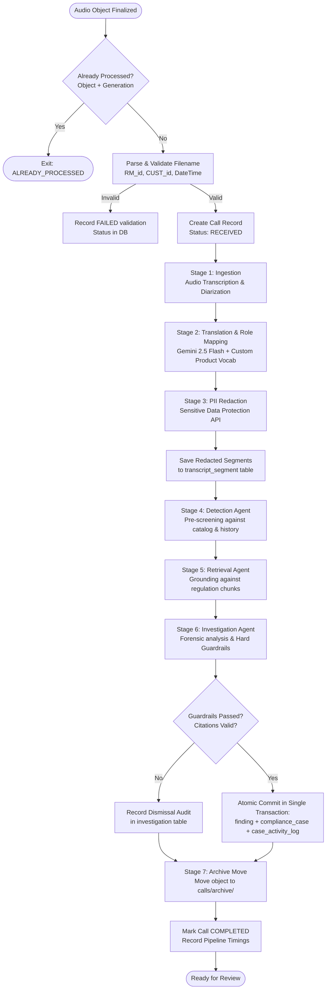
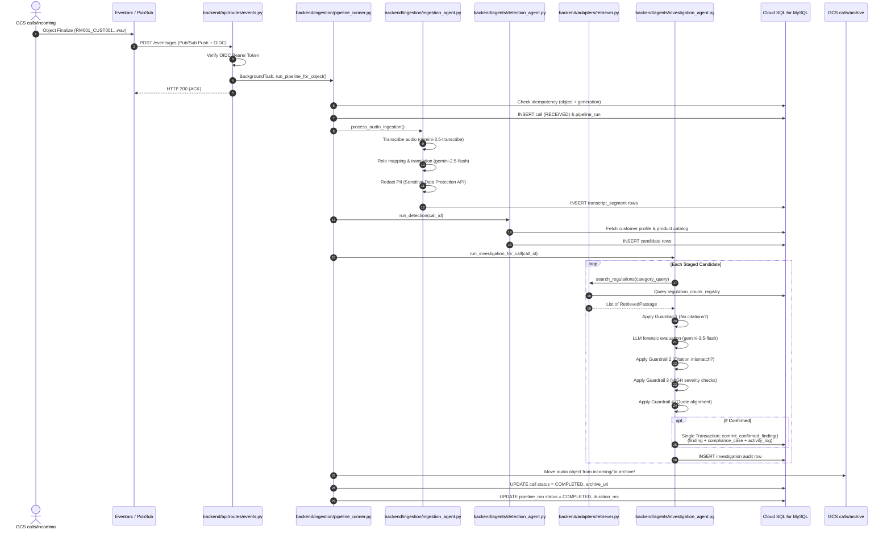
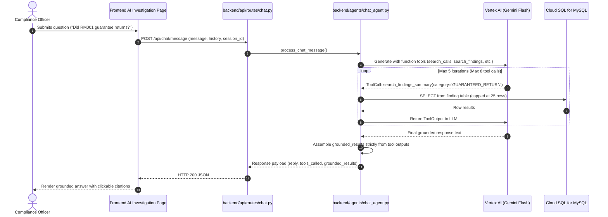

# ARGUS — System Architecture & Data Flow

Detailed architectural specification, distributed event flow, sequence diagrams, and design decisions for the ARGUS platform.

[Back to documentation index](./INDEX.md) | [Next: Technology Stack](./TECH_STACK.md)

---

## Table of Contents

- [System Context](#system-context)
- [Component Architecture](#component-architecture)
- [Pipeline Flowchart](#pipeline-flowchart)
- [Sequence Diagrams](#sequence-diagrams)
  - [Call Processing Sequence](#call-processing-sequence)
  - [AI Investigation Chat Sequence](#ai-investigation-chat-sequence)
- [Event Ingestion Path](#event-ingestion-path)
- [Idempotency & State Machine](#idempotency--state-machine)
  - [Idempotency Design](#idempotency-design)
  - [Pipeline State Machine](#pipeline-state-machine)
- [Failure Handling & Resiliency](#failure-handling--resiliency)
- [Design Decisions & Trade-Offs](#design-decisions--trade-offs)
- [Related Documents](#related-documents)

---

## System Context

ARGUS operates as an event-driven compliance intelligence engine hosted on Google Cloud Platform, bridging raw acoustic telephony streams with institutional compliance casework:



---

## Component Architecture

The application is decomposed into specialized functional layers with clean separation between transport, domain orchestration, and external adapters:

```mermaid
graph TB
    subgraph Frontend["Frontend Layer (React 18 + Vite)"]
        UI_Dash[Operational & Admin Dashboards]
        UI_Audio[WaveSurfer Audio Player]
        UI_Chain[Evidence Chain Inspector]
        UI_Chat[AI Investigation Assistant]
        UI_Theme[Dual-Theme Engine + Owl Toggle]
    end

    subgraph API["Transport Layer (FastAPI)"]
        R_Events["/events/gcs & /api/pipeline/process-now"]
        R_Cases["/api/cases/* (Evidence Chain)"]
        R_Calls["/api/calls/* (HTTP 206 Audio Streaming)"]
        R_Chat["/api/chat/* (SELECT-only Assistant)"]
        R_Reg["/api/regulations/* & /api/documents/*"]
        R_Admin["/api/admin/* (Master Data CRUD)"]
        R_System["/api/system/health & /api/system/diagnostics"]
    end

    subgraph Pipeline["Orchestration Layer (Pipeline Runner)"]
        Runner[Pipeline Runner Engine]
        IngestAgent[Ingestion Agent]
        DetectAgent[Detection Agent]
        InvestAgent[Investigation Agent]
        Guardrails[Hard Guardrails Filter]
    end

    subgraph Adapters["Infrastructure Adapters Layer"]
        Ad_Store[ObjectStore: GCS / Local]
        Ad_Trans[Transcriber: Gemini Audio / Mock]
        Ad_LLM[LLM Client: Vertex AI / Mock]
        Ad_Ret[Retriever: Chunk Registry / File Search]
        Ad_DLP[PII Redactor: Sensitive Data Protection]
        Ad_DB[Database Manager: Cloud SQL Connector]
    end

    Frontend --> API
    API --> Pipeline
    Pipeline --> Adapters
```



Source implementations:
- Router: [`../backend/main.py`](../backend/main.py)
- Configuration: [`../backend/core/config.py`](../backend/core/config.py)
- Adapters: [`../backend/adapters/`](../backend/adapters/)

---

## Pipeline Flowchart

The surveillance pipeline processes an uploaded call through sequential stages, writing granular timing telemetry at each step:



---

## Sequence Diagrams

### Call Processing Sequence



### AI Investigation Chat Sequence



---

## Event Ingestion Path

The cloud ingestion pathway guarantees decoupled, near-real-time ingestion while preventing request timeouts:

1. **Ingress Upload:** Audio files are dropped into `gs://<YOUR_CALLS_BUCKET>/calls/incoming/`.
2. **Event Notification:** GCS triggers a Google Eventarc `google.cloud.storage.object.v1.finalized` event.
3. **Pub/Sub Invocation:** Eventarc pushes the event through a dedicated Pub/Sub topic to `https://<YOUR_BACKEND_URL>/events/gcs`.
4. **OIDC Verification:** The backend verifies that the HTTP request Bearer token was signed by Google Cloud and originates from the authorized invoker service account (`argus-eventarc-invoker-sa@<YOUR_GCP_PROJECT_ID>.iam.gserviceaccount.com`).
5. **Immediate Acknowledgment:** The endpoint acknowledges receipt (`HTTP 200 {"status": "ACK_SCHEDULED"}`) within 50 ms to prevent Pub/Sub redelivery storms.
6. **Background Task Execution:** The actual multi-stage analysis executes within a FastAPI `BackgroundTask` worker thread.

Source implementation: [`../backend/api/routes/events.py`](../backend/api/routes/events.py)

---

## Idempotency & State Machine

### Idempotency Design

Duplicate event deliveries can occur in distributed Pub/Sub systems. ARGUS prevents redundant processing through three explicit safeguards:

1. **Generation-Keyed Deduplication:** Every GCS object finalize event carries an immutable `generation` integer. Before pipeline execution, the runner checks:
   ```sql
   SELECT id, status FROM `call`
   WHERE gcs_uri_incoming LIKE %s AND source_object_generation = %s
   ```
   If a completed record exists, the event is acknowledged and immediately skipped.
2. **Deterministic Primary Keys:** Entity keys are deterministically generated from call IDs and candidate indices (e.g. `CAND-RM001_CUST001_20260310_1030_1`, `FND-...`, `CASE-...`).
3. **Idempotent MySQL Upserts:** Inserts into `candidate`, `investigation`, and `finding` utilize `ON DUPLICATE KEY UPDATE` to avoid duplicate primary key collisions.

### Pipeline State Machine

A call progresses through strict state transitions recorded in the database:

```
                  ┌──────────────────────┐
                  │       RECEIVED       │
                  └──────────┬───────────┘
                             │
            ┌────────────────┴────────────────┐
            ▼                                 ▼
   [Validation Failed]               [Validation Passed]
            │                                 │
            ▼                                 ▼
┌──────────────────────┐          ┌──────────────────────┐
│  FAILED(validation)  │          │      PROCESSING      │
└──────────────────────┘          └──────────┬───────────┘
                                             │
                             ┌───────────────┴───────────────┐
                             ▼                               ▼
                  [Pipeline Stage Error]          [All Stages Complete]
                             │                               │
                             ▼                               ▼
                  ┌──────────────────────┐        ┌──────────────────────┐
                  │        FAILED        │        │      COMPLETED       │
                  └──────────────────────┘        └──────────────────────┘
```

The database tracks transitions in two tables:
- `` `call`.status ``: High-level lifecycle state (`RECEIVED`, `COMPLETED`, `FAILED`, `FAILED(validation)`).
- `pipeline_run.status` & `pipeline_stage_timing`: Sub-second timing for every constituent step.

---

## Failure Handling & Resiliency

1. **Pub/Sub Poison Pill Protection:** If an uploaded audio file is corrupted or carries an invalid filename pattern, the pipeline records a `FAILED(validation)` entry and acknowledges the Pub/Sub message. This stops repeated retries and prevents event-loop exhaustion.
2. **Transient Model Rate Limits:** Vertex AI QPM limits are mitigated by a 1.0-second inter-candidate sleep interval in `backend/agents/investigation_agent.py`.
3. **Storage Fallback:** If Cloud Storage is temporarily degraded, local disk backups under `data/storage/` provide continuity during offline mock execution.
4. **State Machine 409 Conflict Safety:** Concurrent compliance officer actions (such as attempting to dismiss a case that another officer already reviewed) trigger structured `HTTP 409 Conflict` exceptions, preserving audit trail integrity.

---

## Design Decisions & Trade-Offs

| Decision | Chosen Approach | Alternative Considered | Rationale & Trade-Off |
|---|---|---|---|
| **Guardrail Enforcement** | In-code Python logic (`investigation_agent.py`) | Relying solely on LLM system prompt instructions | System prompts can be bypassed or misinterpreted; deterministic Python assertions guarantee 0% hallucinated citations. |
| **Retrieval Strategy** | Direct Cloud SQL Chunk Registry + File Search | External vector database (Pinecone, Milvus, Qdrant) | Embedding the statutory chunk registry directly into Cloud SQL MySQL eliminated an external service dependency, enabling ACID-compliant foreign keys between findings and statutory chunks. |
| **Model Distribution** | Vertex AI `gemini-3.5-flash` for reasoning; `gemini-2.5-flash` for speaker roles | Single model across all tasks | `gemini-2.5-flash` provides rapid, accurate speaker identification and role assignment; `gemini-3.5-flash` handles complex legal reasoning and multi-turn chat. |
| **Persistence Transaction** | Single ACID MySQL transaction for finding, case, and audit log | Multi-step individual REST/DB writes | Guarantees that a confirmed finding can never exist without a corresponding compliance case and audit log entry. |
| **Dual Provider Adapters** | Abstract Base Classes with `Mock` and `Live` adapters | Mocking at HTTP/network boundary | Enables 100% offline development, test automation, and CI validation without requiring Google Cloud credentials or incurring API costs. |

---

## Related Documents

- [Product Overview](./OVERVIEW.md)
- [Technology Stack](./TECH_STACK.md)
- [Agents & Guardrails](./AGENTS.md)
- [Observability Architecture](./OBSERVABILITY.md)
- [Security & Governance](./SECURITY.md)
