# ARGUS — Screenshot Gallery & Interface Walkthrough

Visual walkthrough of the ARGUS user interface across dark and light themes, demonstrating high-density surveillance telemetry, the Evidence Chain, and interactive waveforms.

[Back to documentation index](./INDEX.md) | [Next: Roadmap & Known Limitations](./ROADMAP.md)

---

## Table of Contents

- [Environment & Visual Design Philosophy](#environment--visual-design-philosophy)
- [1. Authentication & Login Interface](#1-authentication--login-interface)
- [2. Operational Surveillance Dashboard](#2-operational-surveillance-dashboard)
- [3. Executive Analytics Dashboard](#3-executive-analytics-dashboard)
- [4. Conversational AI Investigation Assistant](#4-conversational-ai-investigation-assistant)
- [5. Surveillance Calls Roster](#5-surveillance-calls-roster)
- [6. Compliance Cases & Evidence Chain](#6-compliance-cases--evidence-chain)
- [7. Relationship Manager Analytics](#7-relationship-manager-analytics)
- [8. Statutory Regulations Corpus](#8-statutory-regulations-corpus)
- [9. Regulatory Document Management](#9-regulatory-document-management)
- [10. Observability & APM Telemetry](#10-observability--apm-telemetry)
- [11. Platform Settings & Model Telemetry](#11-platform-settings--model-telemetry)
- [12. Collapsible Navigation Sidebar](#12-collapsible-navigation-sidebar)
- [Related Documents](#related-documents)

---

## Environment & Visual Design Philosophy

All screenshots in this gallery were captured from the deployed application environment during Phase 2 verification. All customer names, account numbers, relationship manager names, and phone numbers shown are **100% synthetic demonstration fixtures** generated for testing purposes.

ARGUS adheres to a high-density, tailored visual design system:
- **Dark Theme (Default):** Deep slate canvas (`#06080F`, `#0B1120`), dark card surfaces (`#0F172A`), sharp borders (`#1E293B`), and high-contrast typography.
- **Light Theme:** High-contrast crisp paper canvas (`#F8FAFC`, `#F0F4FF`), clean white card surfaces (`#FFFFFF`), and soft borders (`#E2E8F0`).
- **Interactive Owl Toggle:** The custom animated owl widget at the base of the sidebar allows instant theme transitions with matching day/night background animations.

---

## 1. Authentication & Login Interface

The login interface features a dynamic HTML5 audio wave visualizer that increases in amplitude as the user types credentials, a cycling reel of transcribed sales dialogue snippets, and preview cards illustrating compliance violation detections.

| Dark Theme | Light Theme |
|:---:|:---:|
| 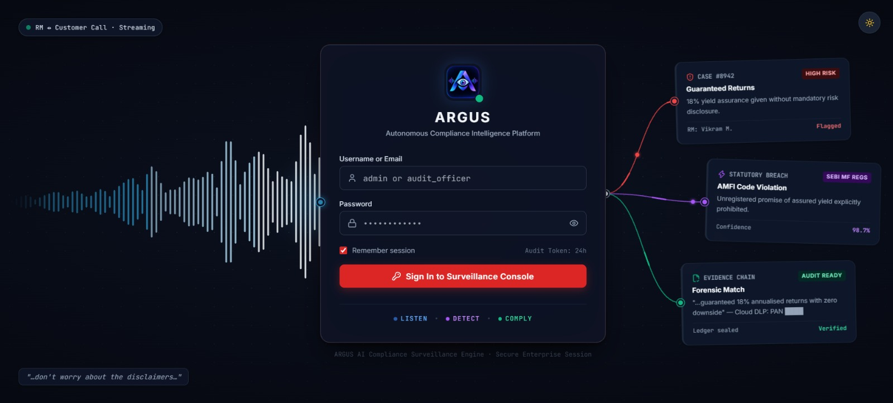 |  |

---

## 2. Operational Surveillance Dashboard

The primary working view for compliance officers. Displays surveillance KPIs (total monitored calls, detected violations, open cases requiring action, average processing latency), time-series trend lines, statutory violation category distributions, and a prioritized feed of recent critical compliance cases.

| Dark Theme | Light Theme |
|:---:|:---:|
| 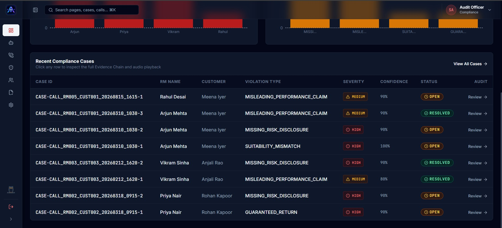 |  |

---

## 3. Executive Analytics Dashboard

Designed for compliance heads and senior executives. Aggregates institutional compliance metrics across relationship managers, displaying cross-branch violation heatmaps, risk severity distributions, and long-term trend lines.

| Dark Theme | Light Theme |
|:---:|:---:|
| 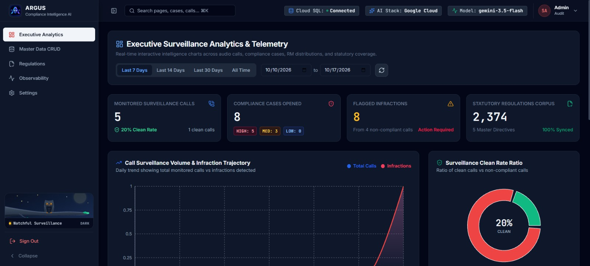 | 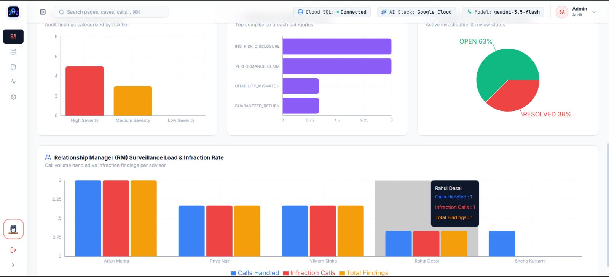 |

---

## 4. Conversational AI Investigation Assistant

An interactive compliance copilot powered by Gemini Flash with function tool calling over seven read-only database inspection tools. Officers can investigate complex multi-call patterns, inspect customer risk profiles, and examine statutory circulars with grounded citations and tool execution badges.

| Dark Theme | Light Theme |
|:---:|:---:|
| 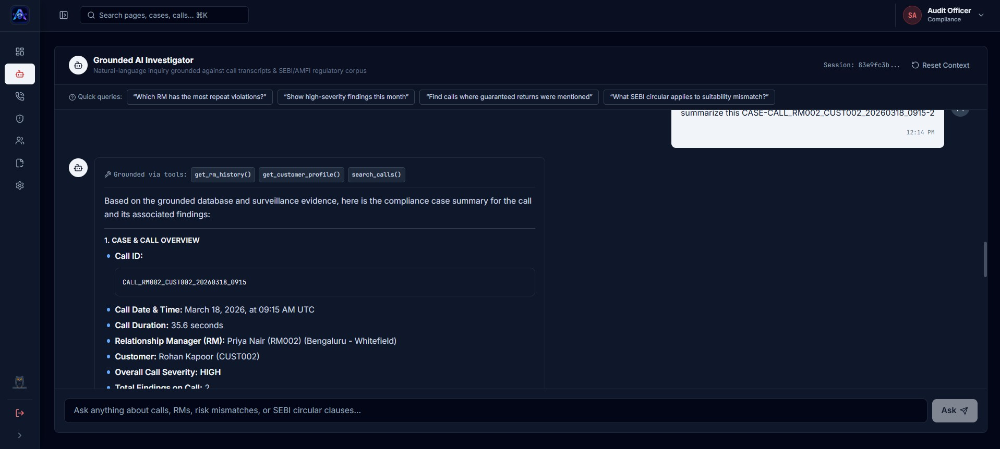 |  |

---

## 5. Surveillance Calls Roster

Presents a paginated, filterable roster of all ingested telephony audio recordings. Officers can filter by relationship manager, customer, severity badge, or processing status, inspecting call duration and violation counts at a glance.

| Dark Theme | Light Theme |
|:---:|:---:|
| 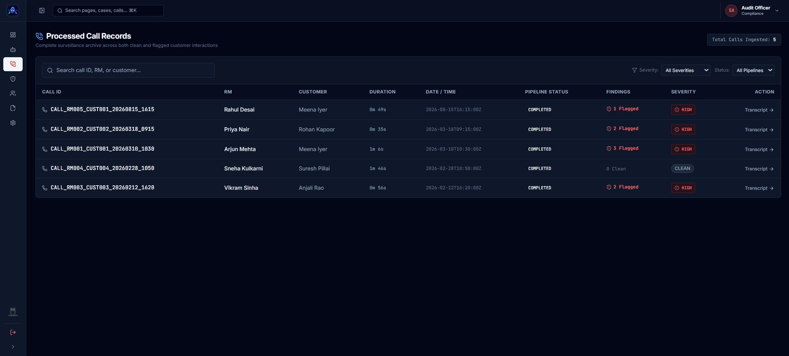 |  |

---

## 6. Compliance Cases & Evidence Chain

The central casework interface displaying all staged and confirmed compliance cases. Features the dynamic `needs_review` filter flag, severity badges, and case action buttons (Review, Dismiss, Escalate). The Evidence Chain presents verbatim quotes, audio timestamps, customer profiles, and binding SEBI citations.

| Dark Theme | Light Theme |
|:---:|:---:|
| 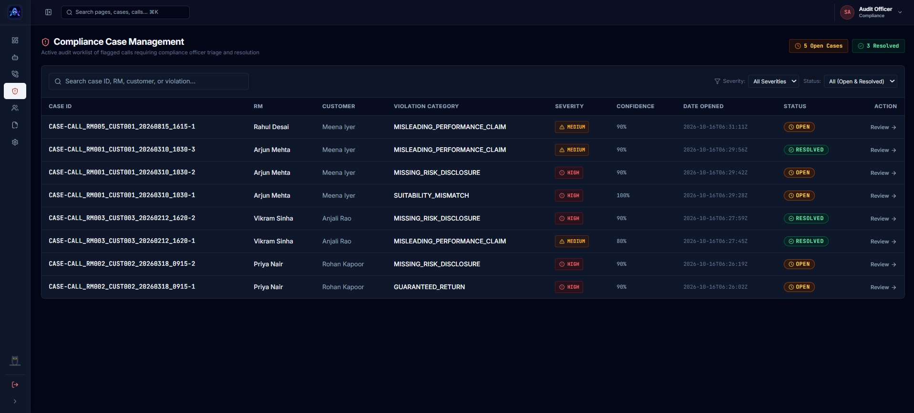 |  |

---

## 7. Relationship Manager Analytics

Surveillance dossier across the institutional RM roster. Ranks sales representatives by computed risk scores, aggregates historical call volumes and breach frequencies, and provides a one-click modal to generate and dispatch authoritative compliance reports via email.

| Dark Theme | Light Theme |
|:---:|:---:|
|  | 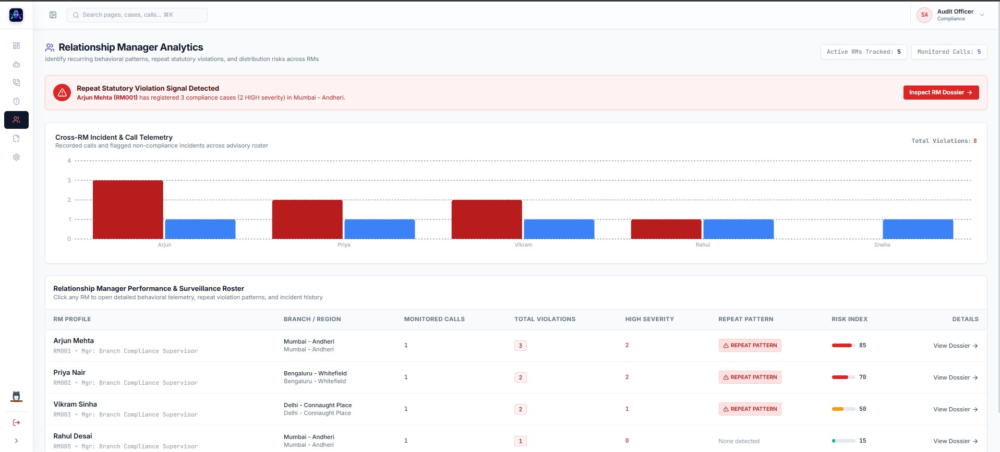 |

---

## 8. Statutory Regulations Corpus

Authoritative statutory regulation browser grounded in Cloud SQL. Displays the 5 master regulatory circulars, total indexed clause counts, publication years, and status flags (`current` vs `legacy`), with in-browser PDF preview and download capabilities.

| Dark Theme | Light Theme |
|:---:|:---:|
| 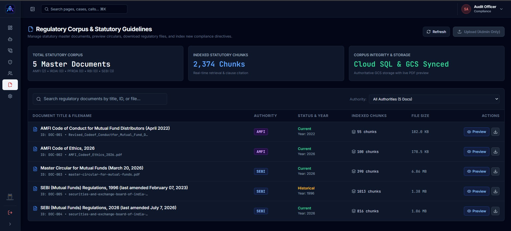 | 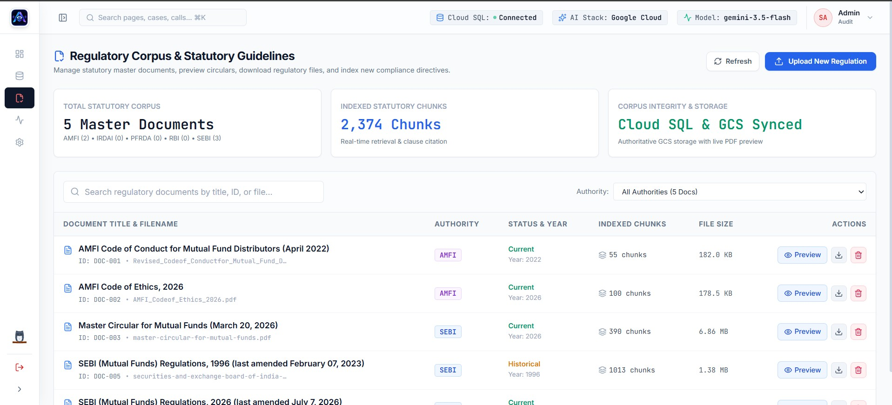 |

---

## 9. Regulatory Document Management

Administrative management screen allowing compliance officers to upload new SEBI and AMFI circular PDFs via multipart upload. Uploaded documents are automatically parsed, split into clause chunks, and registered in the grounding chunk registry.

| Dark Theme | Light Theme |
|:---:|:---:|
| 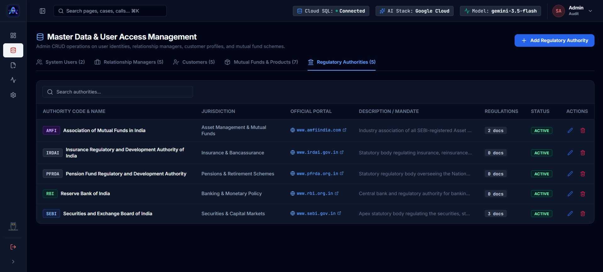 | 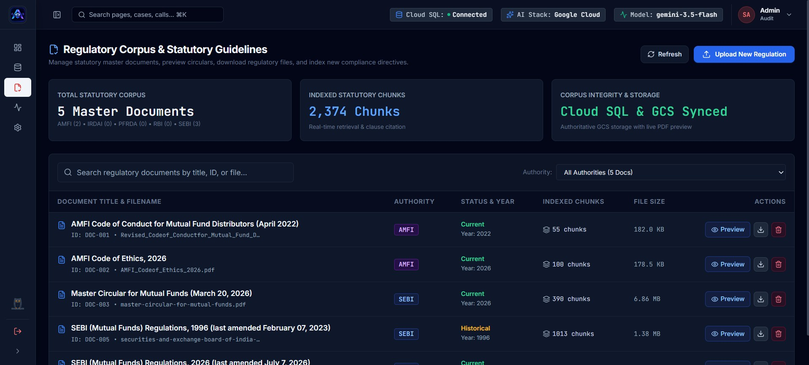 |

---

## 10. Observability & APM Telemetry

Real-time pipeline performance analytics and telemetry dashboard. Displays statistical latency distributions (mean, median, min, max) for ingestion, detection, and investigation stages, an error event ring buffer, and live service health indicators.

| Dark Theme | Light Theme |
|:---:|:---:|
| 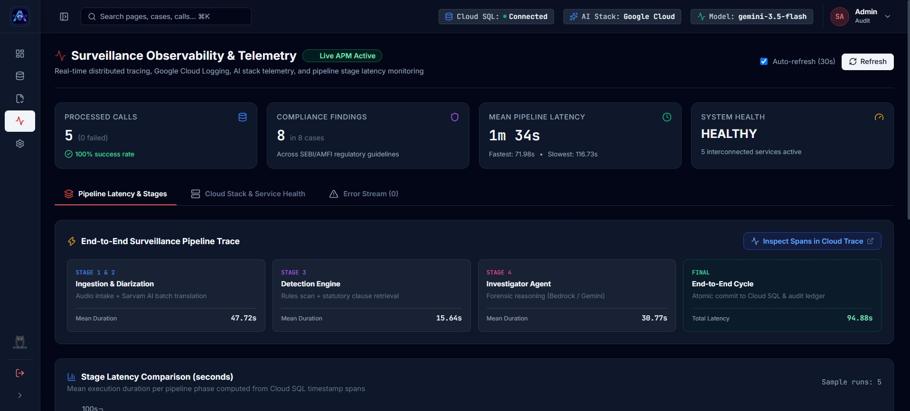 | 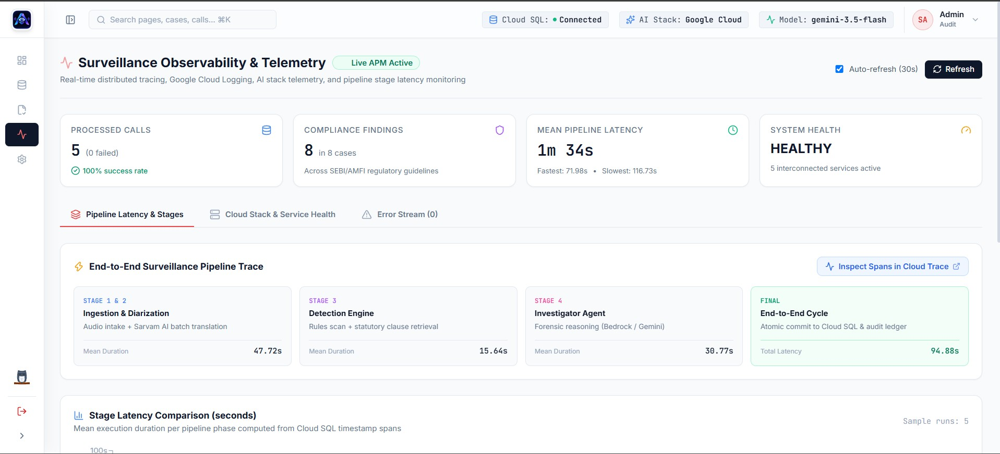 |

---

## 11. Platform Settings & Model Telemetry

Configuration management portal. Allows authorized officers to adjust candidate confidence threshold sliders, view the Cloud Trace deep link template, and inspect the real AI Provider Execution Status table computed directly from database findings.

| Dark Theme | Light Theme |
|:---:|:---:|
| 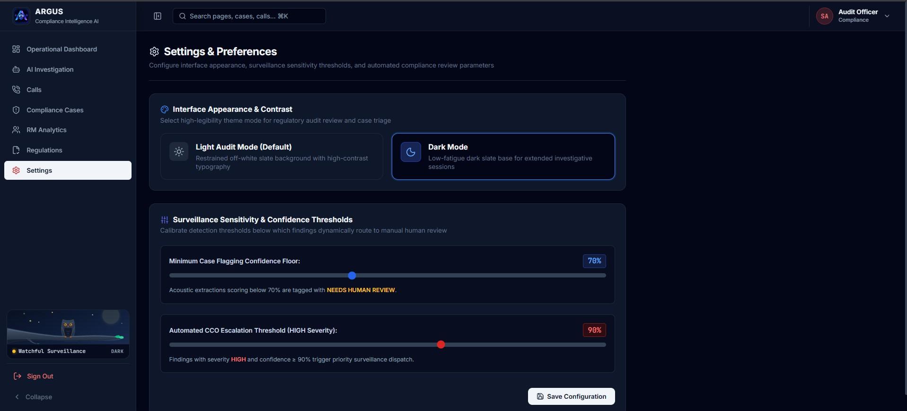 | 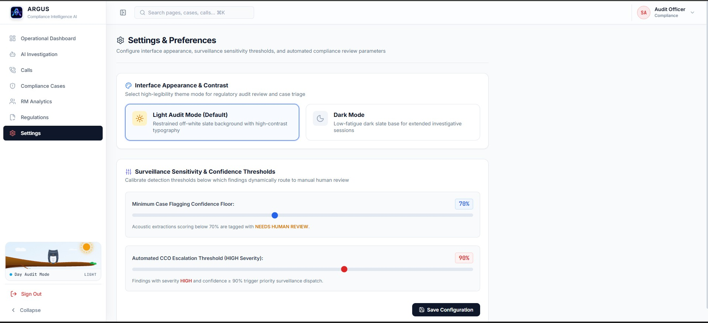 |

---

## 12. Collapsible Navigation Sidebar

The primary application navigation sidebar in expanded and collapsed states, showing role-aware navigation items and the custom animated SVG owl theme toggle.

| Expanded Sidebar | Collapsed Sidebar |
|:---:|:---:|
| 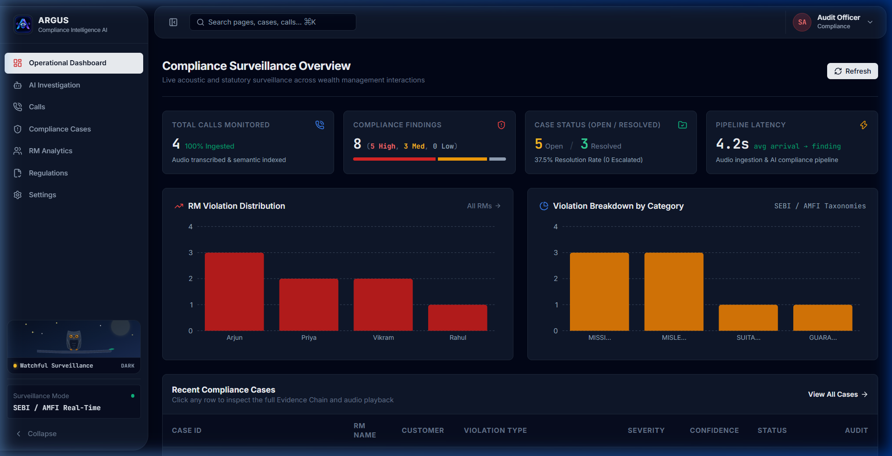 | 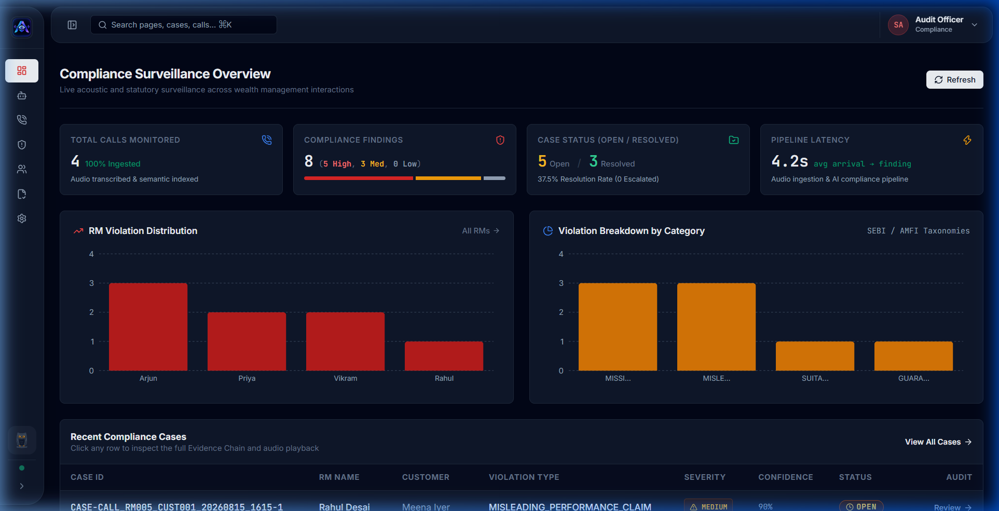 |
| *(Dark Theme)* | *(Dark Theme)* |
| 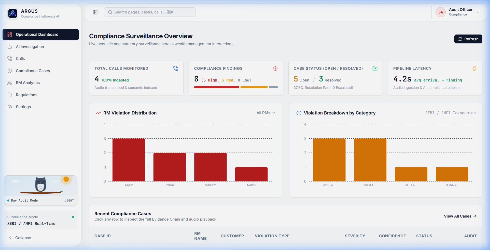 | 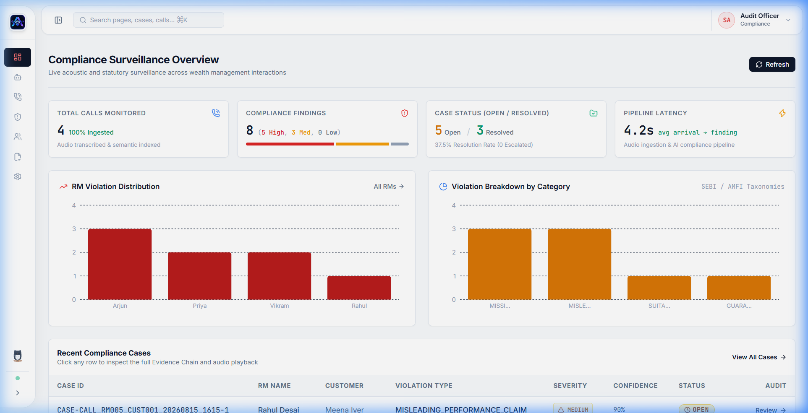 |
| *(Light Theme)* | *(Light Theme)* |

---

## Related Documents

- [Product Overview & Evidence Chain](./OVERVIEW.md)
- [Frontend Architecture](./FRONTEND.md)
- [REST API Reference](./API.md)
- [Testing & Benchmark](./TESTING.md)
